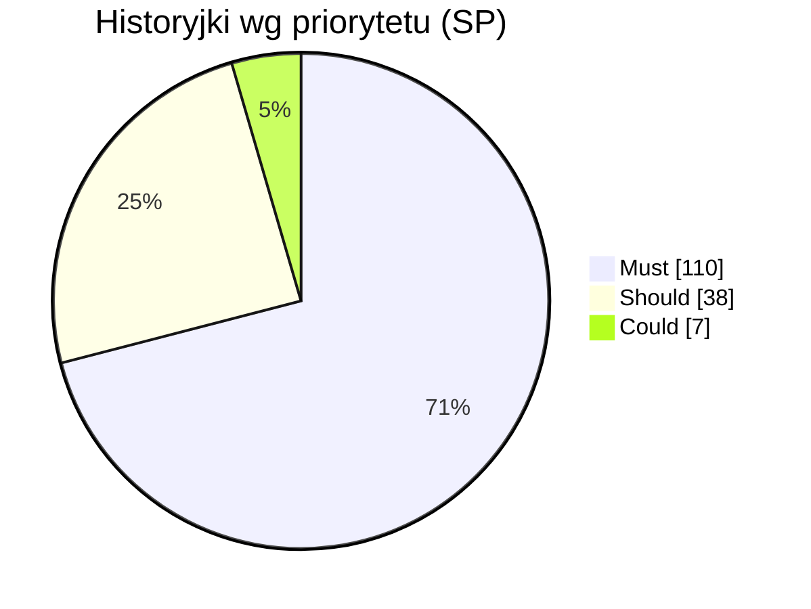
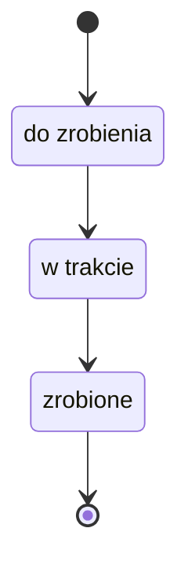

# Backlog produktu

Backlog platformy do prowadzenia lig i turniejów e-sportowych. Szczegółowe opisy i kryteria akceptacji są w [User Stories](../01-start-projektu/user-stories.md). Ta sama lista w formie arkusza: [`backlog.csv`](backlog.csv). Punkty są rozpisane w [estymacji](estymacja.md).

Stan na 10.11.2026.

## Zasady prowadzenia backlogu

- Priorytety według **MoSCoW**: Must musi być na zaliczenie, Should robimy potem, Could jeśli zostanie czas.
- Historyjki pochodzą z event stormingu, ekranów z Figmy i ustaleń front-back.
- Zadania z numerem `#` to issue już założone na GitHubie; zadania bez numeru zakładamy na początku sprintu.
- Zadania oznaczone gwiazdką (nowe*) zostały dopisane przy rozpisywaniu historyjek, a ich punkty są wstępne.
- Kolejność pracy: najpierw Must, potem Should, na końcu Could.

## Lista historyjek

| ID | Historyjka | Epik | Priorytet | SP | Status |
|----|-----------|------|-----------|----|--------|
| US-01 | Rejestracja i logowanie e-mailem | Konto i dostęp | Must | 12 | w trakcie |
| US-02 | Logowanie przez Discord | Konto i dostęp | Should | 5 | do zrobienia |
| US-03 | Utworzenie drużyny | Drużyny | Must | 8 | do zrobienia |
| US-04 | Zapraszanie zawodników do drużyny | Drużyny | Must | 6 | do zrobienia |
| US-05 | Tworzenie rozgrywek | Organizacja rozgrywek | Must | 8 | do zrobienia |
| US-06 | Zapis drużyny do rozgrywek | Organizacja rozgrywek | Must | 5 | do zrobienia |
| US-07 | Automatyczny terminarz ligi | Organizacja rozgrywek | Must | 5 | do zrobienia |
| US-08 | Automatyczna drabinka pucharu | Organizacja rozgrywek | Must | 5 | do zrobienia |
| US-09 | Lista rozgrywek z filtrami | Przeglądanie rozgrywek | Must | 11 | w trakcie |
| US-10 | Strona ligi i obserwowanie | Przeglądanie rozgrywek | Must | 11 | w trakcie |
| US-11 | Tabela ligi | Przeglądanie rozgrywek | Must | 10 | do zrobienia |
| US-12 | Terminarz i wyniki meczów | Przeglądanie rozgrywek | Must | 5 | w trakcie |
| US-13 | Podgląd drabinki pucharu | Przeglądanie rozgrywek | Must | 11 | do zrobienia |
| US-14 | Mecze do rozliczenia | Wyniki meczów | Should | 3 | do zrobienia |
| US-15 | Zgłoszenie i potwierdzenie wyniku | Wyniki meczów | Must | 13 | do zrobienia |
| US-16 | Spór o wynik | Wyniki meczów | Should | 10 | do zrobienia |
| US-17 | Rozstrzygnięcie sporu | Wyniki meczów | Should | 3 | do zrobienia |
| US-18 | Wyniki na żywo | Wyniki na żywo | Should | 10 | do zrobienia |
| US-19 | Zarządzanie rolami | Administracja | Should | 7 | w trakcie |
| US-20 | Log aktywności | Administracja | Could | 7 | do zrobienia |

Razem historyjki: **155 SP** (Must 110 SP, Should 38 SP, Could 7 SP).

## Podział według priorytetu

## Zadania techniczne (82 SP)

To nie są historyjki, tylko rzeczy, bez których reszta by nie działała. Liczymy je do punktów tak samo.

| Obszar | SP | Zakres |
|--------|----|--------|
| Komponenty UI | 33 | TextField, Select, Checkbox i Switch, Spinner, Badge, LiveIndicator, Avatar, Skeleton, EmptyState, Card, Tabs, Modal, Alert, Pagination, Toast oraz header i dolne menu |
| Frontend: konfiguracja i testy | 16 | ESLint i Prettier, klient API, mocki MSW, testy e2e w Playwright |
| Backend: baza, konfiguracja, testy | 23 | schemat bazy, seedery, dokumentacja API w Scramble, CI na PostgreSQL, pliki na dysku, testy endpointów |
| Wdrożenie i dokumentacja API | 10 | wdrożenie backendu, publikacja dokumentacji API i dane do prezentacji |

## Statusy historyjek

