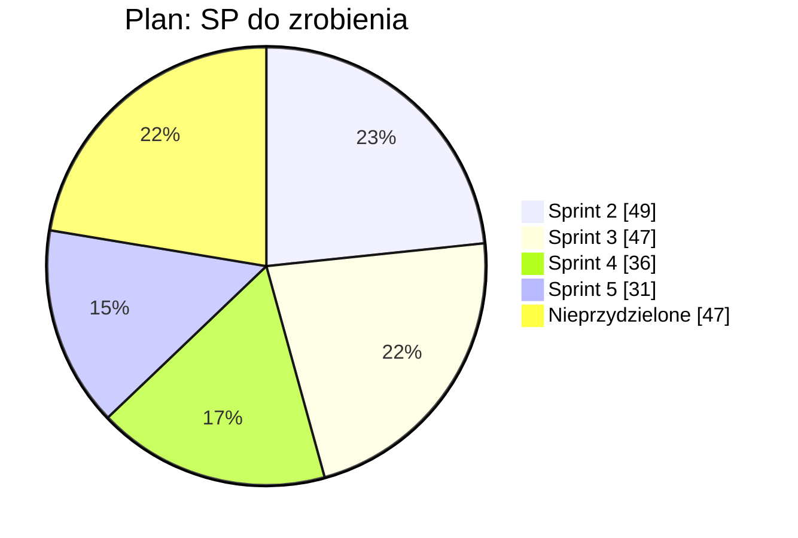

# Estymacja i planowanie sprintów

Stan na 10.11.2026. Powiązane: [Backlog](backlog-management.md) · [Retrospektywy](../05-retrospektywa/retrospektywy.md) · [Metryki](../05-retrospektywa/metryki.md)

## Jak liczymy punkty

- Wyceniamy w story pointach według ciągu Fibonacciego: 1, 2, 3, 5, 8.
- Jeśli coś wychodzi więcej niż 8, dzielimy to na mniejsze zadania.
- Na start przyjęliśmy, że **1 SP to mniej więcej 2 godziny pracy**, żeby mieć odniesienie.
- Zadanie wycenia osoba, która je robi, a reszta zespołu sprawdza wycenę na planowaniu sprintu.
- Nowe zadania (z gwiazdką w backlogu) przejdziemy razem na planowaniu Sprintu 3.

Przykłady do porównań:

| Zadanie | SP |
|---------|----|
| Badge (komponent UI) | 1 |
| TextField | 3 |
| Generator terminarza | 5 |
| Cały ekran ligi | 8 |

## Ile tego jest

| Zakres | SP |
|--------|----|
| Historyjki (20) | 155 |
| Zadania techniczne | 82 |
| **Razem** | **237** |

Z tego 47 SP doszło przy rozpisywaniu historyjek: drużyny, zaproszenia, tworzenie rozgrywek, zapisy, ekran logowania i panel admina. Wcześniej nie były rozpisane, bo nie było ich na ekranach z Figmy.

Po priorytetach: Must 110 SP, Should 38 SP, Could 7 SP (historyjki).

## Sprint 1: plan a wykonanie

| | SP |
|--|----|
| Zaplanowano | 43 |
| Zrobiono | 23 |

Frontend szedł prawie zgodnie z planem, a backend dopiero się rozkręcał (więcej w [retrospektywie](../05-retrospektywa/retrospektywy.md)). Wynik Sprintu 2 zostanie dopisany po jego zamknięciu.

## Plan sprintów

| Sprint | Termin | Do zrobienia (SP) |
|--------|--------|-------------------|
| 2 | 03.11-16.11 | 49 |
| 3 | 17.11-30.11 | 47 |
| 4 | 01.12-14.12 | 36 |
| 5 | 15.12-11.01 | 31 |
| nowe, jeszcze nieprzydzielone | | 47 |
| **Razem** | | **210** |

## Czy zdążymy

- Zostało 210 SP na 4 sprinty, czyli około 52 SP na sprint. W tempie z Sprintu 1 (23 SP) tego nie zrobimy.
- Historyjki Must (110 SP) razem z zadaniami technicznymi (82 SP) to 192 SP; żeby zdążyć przynajmniej z nimi, potrzebne jest tempo rzędu 40-50 SP na sprint.
- Dlatego najpierw robimy Must, potem Should, a Could na końcu.

### Co odpuszczamy w pierwszej kolejności

1. Log aktywności (US-20, Could).
2. Logowanie przez Discord (US-02).
3. Panel administracji (US-19).

Wyniki na żywo (US-18) w najgorszym wypadku zastąpimy odświeżaniem strony co kilka sekund.

### Wyrównanie obciążenia

W Sprincie 3 na backendzie jedna osoba ma 18 SP, a druga 10 SP, więc część zadań trzeba przerzucić. Po każdym sprincie poprawiamy te liczby.
