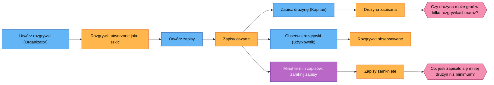
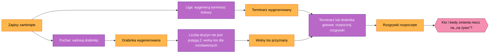
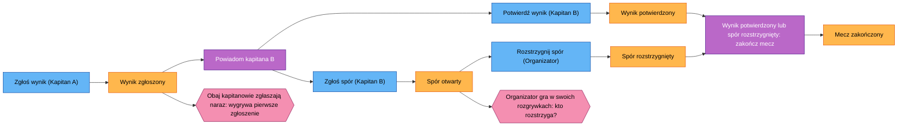
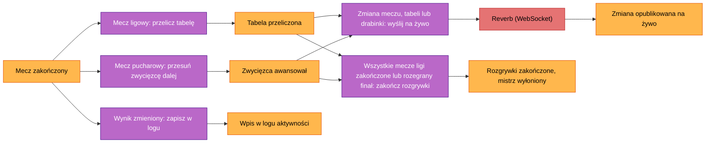

# Event Storming

Platforma do prowadzenia lig i turniejów e-sportowych. Zespół: Jakub Maliński (lider), Wojciech Kasprzyk, Michał Kuchar, Kyrylo Shchedrin. Collegium Witelona, informatyka, grupa 1.1. Data: 18.11.2026.

Najpierw wypisaliśmy wszystko, co się dzieje w systemie (od założenia konta do końca rozgrywek) i ułożyliśmy to po kolei. Potem dopisaliśmy, kto co robi, co dzieje się automatycznie i gdzie mamy wątpliwości. Na końcu podzieliliśmy to na części systemu. Z tego powstał [backlog](backlog-management.md).

## Legenda

Kolory jak na karteczkach:

| Kolor | Znaczenie |
|-------|-----------|
| pomarańczowy | zdarzenie |
| niebieski | komenda |
| żółty | aktor (kto to robi) |
| fioletowy | polityka (co system robi sam) |
| zielony | widok |
| czerwony | system zewnętrzny |
| różowy | pytanie lub problem |

## Aktorzy

| Aktor | Co robi |
|-------|---------|
| Gość | Bez konta; może tylko przeglądać rozgrywki, tabelę i drabinkę. |
| Użytkownik | Zalogowany; może obserwować rozgrywki i założyć drużynę. |
| Kapitan | Prowadzi drużynę: zaprasza graczy, zapisuje drużynę do rozgrywek, zgłasza i potwierdza wyniki. |
| Organizator | Tworzy rozgrywki, ustala zasady i rozstrzyga spory. |
| Administrator | Nadaje role, też może rozstrzygać spory. |
| System | Robi samo: zamyka zapisy, generuje terminarz i drabinkę, liczy tabelę. |

## Oś czasu

### 1. Konto i drużyna

```mermaid
flowchart LR
    classDef zd fill:#ffb74d,stroke:#e65100,color:#000
    classDef ko fill:#64b5f6,stroke:#0d47a1,color:#000
    classDef po fill:#ba68c8,stroke:#4a148c,color:#fff
    classDef ex fill:#e57373,stroke:#b71c1c,color:#000
    classDef pyt fill:#f48fb1,stroke:#880e4f,color:#000
    K1["Zarejestruj konto"]:::ko --> Z1["Konto zarejestrowane"]:::zd
    K2["Zaloguj przez Discord"]:::ko --> D["Discord"]:::ex --> Z2["Konto Discord połączone"]:::zd
    Z1 --> Z3["Użytkownik zalogowany"]:::zd
    Z2 --> Z3
    Z3 --> K3["Utwórz drużynę"]:::ko --> Z4["Drużyna utworzona"]:::zd
    Z4 --> P1["Twórca zostaje kapitanem"]:::po --> Z5["Kapitan wyznaczony"]:::zd
    Z5 --> K4["Zaproś zawodnika"]:::ko --> Z6["Zaproszenie wysłane"]:::zd
    Z6 --> K5["Przyjmij zaproszenie"]:::ko --> Z7["Zawodnik dołączył do drużyny"]:::zd
    Z6 --> K6["Odrzuć zaproszenie"]:::ko --> Z8["Zaproszenie odrzucone"]:::zd
    Z7 --> Q1{{"Czy można zmieniać skład w trakcie rozgrywek?"}}:::pyt
```

### 2. Rozgrywki: utworzenie i zapisy

### 3. Start rozgrywek: terminarz i drabinka

### 4. Mecz i wynik

Poza zakresem na ten moment: wycofanie zgłoszenia i automatyczne zatwierdzenie po 24 godzinach.

### 5. Po meczu: tabela, drabinka, na żywo, koniec

## Zdarzenia (w kolejności)

1. Konto zarejestrowane
2. Użytkownik zalogowany (e-mailem albo przez Discorda)
3. Drużyna utworzona
4. Zaproszenie wysłane
5. Zawodnik dołączył do drużyny / zaproszenie odrzucone
6. Rozgrywki utworzone
7. Zapisy otwarte
8. Drużyna zapisana
9. Zapisy zamknięte
10. Terminarz wygenerowany / drabinka wygenerowana
11. Rozgrywki rozpoczęte
12. Wynik zgłoszony
13. Wynik potwierdzony / spór zgłoszony
14. Spór rozstrzygnięty
15. Mecz zakończony
16. Tabela przeliczona / zwycięzca przeszedł dalej
17. Rozgrywki zakończone

## Komendy

| Aktor | Komendy |
|-------|---------|
| Gość | zarejestruj się, zaloguj się, zaloguj przez Discord |
| Użytkownik | utwórz drużynę, przyjmij albo odrzuć zaproszenie, obserwuj rozgrywki |
| Kapitan | zaproś gracza, zapisz drużynę, zgłoś wynik, potwierdź wynik, zgłoś spór |
| Organizator | utwórz rozgrywki, otwórz zapisy, rozstrzygnij spór |
| Administrator | nadaj rolę |

## Agregaty

- **Konto**: użytkownik i jego role.
- **Drużyna**: nazwa, logo, kapitan i skład.
- **Rozgrywki**: liga albo puchar, zasady, terminy i zapisane drużyny.
- **Mecz**: dwie drużyny, wynik, zgłoszenia wyniku i ewentualny spór.

Tabelę i drabinkę liczymy z zakończonych meczów, więc nie są osobnym agregatem (zob. ADR-0008).

## Polityki

- Kto tworzy drużynę, zostaje jej kapitanem.
- Po terminie zapisów zapisy same się zamykają.
- Po zamknięciu zapisów w lidze generuje się terminarz (każdy z każdym), a w pucharze losuje się drabinkę.
- Gdy kapitan zgłosi wynik, drugi kapitan dostaje powiadomienie.
- Gdy wynik jest potwierdzony albo spór rozstrzygnięty, mecz się kończy.
- Po meczu ligowym przeliczamy tabelę, a po pucharowym zwycięzca przechodzi dalej.
- Każda zmiana wyniku, tabeli albo drabinki od razu pokazuje się na stronie.

## Widoki

Lista rozgrywek, strona ligi, tabela, terminarz, drabinka, mecze do rozliczenia i strona meczu z historią zgłoszeń.

## Systemy zewnętrzne

Discord (logowanie) i Reverb (wyniki na żywo).

## Części systemu

System dzieli się na kilka części, które mniej więcej odpowiadają podziałowi pracy w zespole:

1. Konta i role
2. Drużyny
3. Rozgrywki
4. Mecze i wyniki
5. Tabela i drabinka
6. Na żywo

## Pytania i problemy

| Pytanie | Odpowiedź |
|---------|-----------|
| Co, jeśli w pucharze nie ma 4, 8 albo 16 drużyn? | Najlepsze drużyny dostają wolny los i przechodzą dalej bez meczu. |
| Czy w pucharze może być remis? | Nie, formularz na to nie pozwala. |
| Co, jeśli kapitan wpisze zły wynik? | Nie może go poprawić; rywal zgłasza spór i decyduje organizator. |
| Co, jeśli rywal nie potwierdza wyniku? | Na razie decyduje organizator. |
| Co, jeśli zapisze się za mało drużyn? | Jeszcze nie wiemy. |
| Kto przełącza mecz na „na żywo”? | Jeszcze nie wiemy; może po prostu o godzinie meczu. |

## Powiązane dokumenty

[User Stories](../01-start-projektu/user-stories.md) · [Backlog](backlog-management.md) · [ADR](../../../adr/README.md)
